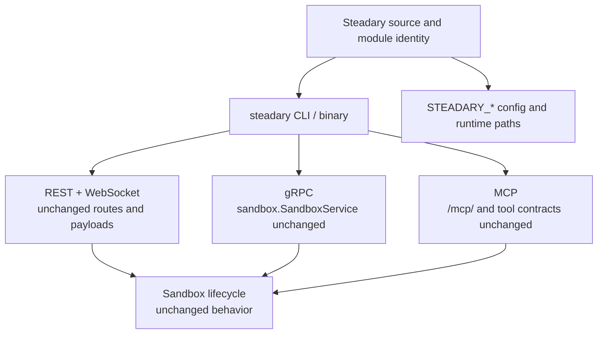

# refactor: Rename Strata to Steadary

## Summary

Rename the project's source, runtime, build, deployment, and documentation identity from Strata to Steadary. The REST, WebSocket, gRPC, and MCP contracts remain compatible: routes, methods, request and response fields, identity headers, service names, and tool identifiers do not change.

---

## Problem Frame

The project is moving to the Steadary name, but it has accumulated the Strata identity across code imports, CLI commands, configuration prefixes, runtime paths, container images, CI artifacts, scripts, and documentation. A partial rename would leave operators and developers with ambiguous commands, mismatched artifacts, and stale instructions.

The rename must be comprehensive without turning a branding change into a protocol migration. Existing clients must continue to call the same API and use the same sandbox data model after the rename.

---

## Requirements

- R1. Make `Steadary` the canonical project name in source identity, CLI output, runtime configuration, build artifacts, container metadata, and current documentation.
- R2. Preserve every REST method, route, request JSON field, response JSON field, status-code convention, WebSocket route, and WebSocket message shape.
- R3. Preserve the gRPC package, service, and method names, including `sandbox.SandboxService`.
- R4. Preserve the MCP endpoint, core tool names (`exec`, `read`, `write`, `edit`), tool schemas, argument names, and identity headers.
- R5. Preserve `owner_id`, `session_id`, `X-Owner-Id`, `X-Session-Id`, session key semantics, sandbox isolation, overlay behavior, TTL behavior, and execution semantics.
- R6. Remove stale Strata references from current code, tests, build configuration, deployment configuration, scripts, and current product documentation, except explicitly preserved API-compatible tool identifiers and historical documents.
- R7. Apply the rename without backward-compatible CLI commands, environment-variable aliases, or old build-artifact names.
- R8. Keep historical release notes and completed historical plans readable rather than rewriting history.
- R9. Prove API compatibility with contract-focused tests and the existing live smoke paths before the rename is considered complete.

---

## Scope Boundaries

- Do not change REST, WebSocket, gRPC, or MCP schemas, routes, methods, headers, or tool contracts.
- Do not change sandbox lifecycle, isolation, overlay drivers, PTY behavior, command execution, session identity, TTL cleanup, or error categories.
- Do not rename the protobuf package `sandbox` or its service and message types.
- Do not rename the StdIO wrapper's existing `strata_exec` and `strata_stats` MCP tool identifiers.
- Do not add compatibility aliases for the old `strata` executable or `STRATA_*` environment-variable prefix.
- Do not migrate active sessions from `/tmp/strata/sessions` or existing Docker volumes as part of the code rename.
- Do not change the default port `2280`.
- Do not rewrite prior release history in `CHANGELOG.md` or completed plans under `docs/plans/`.
- This migration plan may name Strata where needed to describe the source identity and compatibility boundary.
- Do not add new product features or unrelated cleanup.

### Deferred to Follow-Up Work

- Rename the GitHub repository to `liut/steadary` and update external repository links before publishing a release that exposes the new module path.
- Switch deployment hosts from the old `/opt/strata` installation and service naming convention to `/opt/steadary`; retain the old deployment until the cutover is verified.
- Decide whether old session directories or named volumes need a separate migration utility. The rename treats them as transient runtime state.

---

## Context & Research

### Relevant Code and Patterns

- `go.mod` and `Makefile` define the current module and linker identity.
- `pkg/config/config.go` owns the application name, environment prefix, runtime defaults, and MCP server display name.
- `pkg/webapi/handler.go` defines the stable REST and WebSocket route surface.
- `pkg/mcp/tools.go` defines the core MCP tool identifiers and schemas.
- `pkg/proto/sandbox/sandbox.proto` defines the stable gRPC protocol package and service names.
- `pkg/sandbox/` owns session paths, bwrap hostname, filesystem temp markers, overlay errors, and execution markers.
- `Makefile`, `.github/workflows/release.yml`, `.gitlab-ci.yml`, `docker/`, and `.dockerignore` own build and deployment identity.
- `README.md`, `README.zh.md`, `AGENTS.md`, `docs/`, and `scripts/README*.md` contain current operator and developer instructions.

### Institutional Learnings

No relevant material exists under `docs/solutions/`. Existing completed plans and the current test suite establish the repository's convention of testing protocol and handler behavior close to the owning package, with smoke scripts covering assembled services.

### External References

No external research is required. The rename follows established Go module, Cobra, protobuf generation, GitHub Actions, GitLab CI, and Docker conventions already present in the repository.

---

## Key Technical Decisions

| Decision | Choice | Rationale |
|----------|--------|-----------|
| Rename scope | Complete hard rename | The project accepts a clean break for its own CLI, configuration, build, and deployment identity. |
| API compatibility | Preserve routes, schemas, IDs, headers, and behavior | A product rename must not become an unannounced API migration. |
| gRPC identity | Keep `sandbox.SandboxService` and all full method names | Service names are wire contracts, not product branding. |
| Generated protobuf | Change only `go_package`, then regenerate | Hand-editing generated descriptors risks a mismatch between source and generated code. |
| MCP identity | Change the server display name to Steadary; keep core tool IDs and schemas | Client tool calls remain compatible while response metadata reflects the new product name. |
| StdIO wrapper tools | Keep `strata_exec` and `strata_stats` as external tool identifiers | These names are already part of that wrapper's MCP contract and are not renamed by this branding migration. |
| Environment configuration | Replace `STRATA_*` with `STEADARY_*` without aliases | Configuration is part of the accepted hard rename, while protocol contracts remain stable. |
| Runtime state | Use `/tmp/steadary/sessions` by default | The new default matches the new identity; existing `/tmp` session state is treated as transient. |
| Historical documents | Preserve completed plans and old changelog sections | Rewriting historical records would reduce auditability without improving current product identity. |

---

## Open Questions

### Resolved During Planning

- Does the project retain the old `strata` command or `STRATA_*` environment variables? No. This is a hard rename with no compatibility aliases.
- Do REST, WebSocket, gRPC, and MCP contracts change? No. Only brand-bearing display metadata may change.
- Should protobuf files be edited manually? No. Update `go_package` and regenerate the generated Go sources.
- Should the default session directory be migrated automatically? No. The directory is transient and the new default is `/tmp/steadary/sessions`.
- Should historical plans and old changelog releases be rewritten? No. They remain historical records.

### Deferred to Implementation

- The exact ordering of the external repository rename relative to the release branch, provided all local verification passes before publication.
- Whether deployment hosts need a temporary parallel systemd unit during cutover. This depends on production tooling outside the repository.
- Whether additional stale references are discovered in generated or ignored files after regeneration; those should be classified as current identity, historical record, or intentional protocol compatibility.

---

## High-Level Technical Design

> This illustrates the intended boundary between the renamed product identity and the unchanged API surface. It is directional guidance, not implementation specification.

---

## Implementation Units

### U1. Lock the API contract before renaming

**Goal:** Make the externally observable API surface explicit so later broad edits cannot accidentally change routes, schemas, service names, headers, or tool identifiers.

**Requirements:** R2, R3, R4, R5, R9

**Dependencies:** None

**Files:**
- Modify: `pkg/webapi/handler_test.go`
- Modify: `pkg/webapi/ws_test.go`
- Modify: `pkg/mcp/http_transport_test.go`
- Create: `pkg/rpc/service_contract_test.go`

**Approach:**
- Treat the existing routes and wire identifiers as a compatibility baseline.
- Make the MCP test server name parameterized so a display-name change can be verified independently from endpoint and tool-contract compatibility.
- Add focused assertions for the gRPC service descriptor and full method names.
- Keep test fixtures on the public API shapes rather than internal helper names.

**Test scenarios:**
- Happy path: all documented REST method/path pairs remain accepted and return their existing JSON field names.
- Happy path: WebSocket input, resize, output, and error messages retain their existing JSON shape.
- Happy path: all five gRPC full method names retain the `sandbox.SandboxService` package and service prefix.
- Happy path: modern and legacy MCP flows expose exactly `edit,exec,read,write`, the same argument names, and the same identity headers.
- Edge case: changing the MCP display name does not alter the `/mcp/` endpoint or tool inventory.
- Error path: invalid identity, missing command, and invalid tool arguments retain their existing HTTP or MCP error categories.

**Verification:**
- Contract tests pass before any branding edit and continue to express the same external routes, schemas, service names, and tool identifiers after the rename.

---

### U2. Rename the Go module and generated protobuf namespace

**Goal:** Make Steadary the canonical Go module and import identity while preserving the protobuf package and gRPC wire names.

**Requirements:** R1, R3, R6, R7

**Dependencies:** U1

**Files:**
- Modify: `go.mod`
- Modify: `go.sum` only if module resolution requires it
- Modify: `main.go`
- Modify: `cmd/root.go`
- Modify: `cmd/run.go`
- Modify: `cmd/cli.go`
- Modify: `pkg/mcp/handler.go`
- Modify: `pkg/rpc/service.go`
- Modify: `pkg/webapi/exec.go`
- Modify: `pkg/webapi/handler.go`
- Modify: `pkg/webapi/handler_test.go`
- Modify: `pkg/webapi/ws.go`
- Modify: `pkg/proto/sandbox/sandbox.proto`
- Regenerate: `pkg/proto/sandbox/sandbox.pb.go`
- Regenerate: `pkg/proto/sandbox/sandbox_grpc.pb.go`
- Modify: `scripts/test-grpc-shell.go`
- Modify: `Makefile`
- Modify: `.github/workflows/release.yml`
- Modify: `.gitlab-ci.yml`

**Approach:**
- Replace the module root `github.com/liut/strata` with `github.com/liut/steadary` across Go imports.
- Change `option go_package` to the Steadary module path, but keep `package sandbox`, `service SandboxService`, message names, and RPC names unchanged.
- Regenerate protobuf code from the updated source rather than editing generated descriptors.
- Keep unrelated dependencies and generated behavior unchanged.

**Execution note:** Run the API contract tests before and after the module/import rewrite so an import-only defect cannot masquerade as a protocol change.

**Patterns to follow:**
- Existing module-level imports in `main.go` and `cmd/`.
- Existing source-relative protobuf generation configured by `make gen-rpc`.

**Test scenarios:**
- Happy path: all packages compile under `module github.com/liut/steadary`.
- Happy path: regenerated protobuf code still exposes `sandbox.SandboxService` and the same five full method names.
- Edge case: no generated Go file points its `go_package` metadata at `github.com/liut/strata`.
- Integration: the gRPC CLI and shell smoke client resolve the regenerated package while the concrete service descriptor remains unchanged.

**Verification:**
- The repository builds from the new module root and the API contract tests remain green.

---

### U3. Rename runtime identity and configuration

**Goal:** Make the running process, CLI, configuration defaults, logs, internal markers, and sandbox-visible host identity use Steadary without changing API behavior.

**Requirements:** R1, R2, R4, R5, R6, R7

**Dependencies:** U2

**Files:**
- Modify: `cmd/root.go`
- Modify: `cmd/run.go`
- Modify: `cmd/cli.go`
- Modify: `pkg/config/config.go`
- Modify: `pkg/config/config_test.go`
- Modify: `pkg/sandbox/manager.go`
- Modify: `pkg/sandbox/overlay.go`
- Modify: `pkg/sandbox/session.go`
- Modify: `pkg/sandbox/manager_test.go`
- Modify: `pkg/sandbox/session_test.go`
- Modify: `pkg/webapi/exec.go`
- Modify: `pkg/webapi/exec_test.go`
- Modify: `pkg/mcp/file_access.go`
- Modify: `pkg/mcp/file_write_test.go`
- Modify: `pkg/mcp/handler_test.go`
- Modify: `pkg/mcp/http_transport_test.go`

**Approach:**
- Change the Cobra root command, descriptions, startup logs, and CLI banner to Steadary.
- Load configuration through the `STEADARY_*` prefix and change the default server identity and session root to Steadary.
- Update internal temporary-file prefixes, exec completion markers, bwrap hostname, and package-scoped error prefixes.
- Do not alter route registration, JSON tags, identity headers, tool input schemas, or sandbox decisions.
- Update MCP test expectations for the new server display name while retaining tool and endpoint assertions.

**Test scenarios:**
- Happy path: default configuration reports `Name=steadary`, port `2280`, and session root `/tmp/steadary/sessions`.
- Happy path: `STEADARY_SERVER_*` and `STEADARY_SANDBOX_*` variables override their defaults.
- Edge case: obsolete `STRATA_*` variables do not override Steadary configuration after the hard rename.
- Happy path: exec output containing potentially marker-like text is still returned correctly and the new completion marker is never leaked.
- Happy path: atomic writes clean up Steadary-prefixed temporary files.
- Integration: sessions start with the Steadary bwrap hostname while the same REST, WebSocket, gRPC, and MCP calls continue to work.
- Error path: existing invalid timeout, missing identity, and invalid command cases retain their HTTP or MCP error category and response shape.

**Verification:**
- Runtime branding, configuration defaults, and logs are Steadary-owned, while contract tests prove the API behavior is unchanged.

---

### U4. Rename build, release, and container artifacts

**Goal:** Produce and deploy only Steadary-named binaries, archives, images, containers, and service paths.

**Requirements:** R1, R6, R7

**Dependencies:** U2, U3

**Files:**
- Modify: `Makefile`
- Modify: `.github/workflows/release.yml`
- Modify: `.gitlab-ci.yml`
- Modify: `docker/runtime.Dockerfile`
- Modify: `docker/apple-runtime.Dockerfile`
- Modify: `docker/fullbuild.Dockerfile`
- Modify: `docker/docker-compose.yml`
- Modify: `.gitignore`
- Modify: `.dockerignore`

**Approach:**
- Replace `NAME`, `ROOF`, output paths, linker paths, archive names, workflow globs, deployment roots, container names, image tags, volume names, entrypoints, and ignore patterns.
- Keep the listening port, health endpoint, privilege model, runtime dependencies, and container behavior unchanged.
- Treat the GitHub repository rename and production service cutover as external release prerequisites, not as edits that can be completed from this checkout.

**Test scenarios:**
- Happy path: local build produces `dist/steadary`.
- Happy path: Linux release builds produce `steadary-linux-amd64` and `steadary-linux-arm64` archives.
- Happy path: runtime and Apple Container images copy and launch `/opt/bin/steadary`.
- Happy path: Compose exposes port `2280` and health-checks the unchanged `/api/stats` endpoint.
- Edge case: current build and deployment configuration contains no old Strata output path, artifact glob, container name, service name, volume name, or environment prefix.

**Verification:**
- Every produced artifact and runtime entrypoint is Steadary-named, and the container still exposes the unchanged API surface.

---

### U5. Rename scripts and operational helpers

**Goal:** Move project-owned scripts to Steadary naming and configuration while preserving the protocol identifiers they expose to clients.

**Requirements:** R1, R4, R6, R7, R9

**Dependencies:** U2, U3

**Files:**
- Move: `scripts/strata-mcp.ts` to `scripts/steadary-mcp.ts`
- Modify: `scripts/steadary-mcp.ts`
- Modify: `scripts/test-api.sh`
- Modify: `scripts/test-mcp.ts`
- Modify: `scripts/test-grpc.sh`
- Modify: `scripts/test-grpc-shell.go`
- Modify: `scripts/check-env.sh`
- Modify: `scripts/README.md`
- Modify: `scripts/README.zh.md`

**Approach:**
- Replace script names, environment variables, class names, log output, and test sentinel values with Steadary equivalents.
- Keep the StdIO wrapper's `strata_exec` and `strata_stats` tool identifiers because they are external MCP tool names already consumed by clients.
- Keep every script's HTTP paths, JSON payloads, headers, CLI flows, and live service assumptions unchanged.

**Test scenarios:**
- Happy path: the REST smoke script passes against a running Steadary server without changing its API requests.
- Happy path: modern and legacy MCP smoke modes pass with Steadary-prefixed script configuration.
- Happy path: the gRPC shell client builds and exercises the unchanged `sandbox.SandboxService` methods.
- Edge case: the StdIO wrapper still advertises `strata_exec` and `strata_stats`, proving the compatibility exception is intentional.
- Error path: script connection failures continue to identify the configured URL and preserve the same exit behavior.

**Verification:**
- Operational scripts are discoverably Steadary-owned, while all externally callable API paths and compatibility identifiers remain valid.

---

### U6. Update current documentation and audit intentional historical references

**Goal:** Make all current documentation describe Steadary and leave only explicitly justified old-name references.

**Requirements:** R1, R6, R7, R8

**Dependencies:** U2, U3, U4, U5

**Files:**
- Modify: `README.md`
- Modify: `README.zh.md`
- Modify: `AGENTS.md`
- Modify: `CHANGELOG.md`
- Modify: `docs/edit-tool.md`
- Modify: `docs/kernel-overlay-demo.md`
- Modify: `docs/apple-container.md`
- Modify: `docs/apple-container.zh.md`
- Modify: `docker/README.md`

**Approach:**
- Update current commands, paths, environment variables, architecture labels, protocol explanations, and examples to Steadary.
- Add an unreleased changelog entry describing the rename and the explicitly preserved API contracts.
- Leave pre-existing release sections and completed historical plans intact.
- Perform a final reference audit and classify any remaining `strata` text as historical, generated, or intentionally API-compatible.

**Test scenarios:**
- Happy path: all current quick-start, Docker, Apple Container, MCP, and gRPC instructions use executable Steadary commands and paths.
- Happy path: API examples still use the same routes, `owner_id`, `session_id`, and identity headers.
- Edge case: historical changelog entries and completed plans remain unchanged.
- Edge case: compatibility identifiers `strata_exec` and `strata_stats` remain documented where the StdIO wrapper contract requires them.
- Integration: a clean tree has no current Go import, build instruction, deployment instruction, or runtime default pointing at the old Strata identity.

**Verification:**
- The final stale-reference audit reports only approved historical and protocol-compatibility references, with no unexplained current-brand leakage.

---

## System-Wide Impact

- **Interaction graph:** Source and build identity feed the CLI and runtime configuration; runtime configuration feeds the unchanged REST, WebSocket, gRPC, MCP, and sandbox layers.
- **Error propagation:** Error wrappers and logs receive the new brand text, while HTTP status codes, MCP error categories, and gRPC status behavior remain unchanged.
- **State lifecycle risks:** The default session root and Docker volume name change. Existing `/tmp` or named-volume state is not migrated and should be treated as disposable.
- **API surface parity:** REST, WebSocket, gRPC, MCP, identity headers, request fields, response fields, and core tool schemas require parity tests after every rename unit.
- **Integration coverage:** Unit tests prove package behavior; live API, MCP, and gRPC scripts prove the assembled server still accepts the same external calls.
- **Unchanged invariants:** Port `2280`, `/api/*`, `/mcp/`, `sandbox.SandboxService`, `exec/read/write/edit`, `owner_id`, `session_id`, `X-Owner-Id`, `X-Session-Id`, session isolation, overlay, PTY, TTL, and execution semantics do not change.

---

## Risks & Dependencies

| Risk | Mitigation |
|------|------------|
| A broad search-and-replace changes a protobuf or MCP contract identifier | Lock API contracts in U1 and review every old-name replacement against an explicit allowlist. |
| Generated protobuf descriptors diverge from `sandbox.proto` | Change `go_package` only, regenerate with the existing target, and verify gRPC full method names. |
| The new module path is not yet resolvable remotely | Complete the GitHub repository rename before publishing a release that depends on `github.com/liut/steadary`. |
| CI deploys to an old `/opt/strata` service path | Treat deployment cutover as a prerequisite, verify the target service and permission model, and avoid deleting the old deployment during the code change. |
| Changing the default session root appears to lose sessions | Document that runtime state is not migrated and preserve explicit configuration as the rollover mechanism. |
| Historical references are mistaken for missed edits | Maintain an explicit audit allowlist for old changelog sections, completed plans, and retained wire tool identifiers. |
| Configuration users continue setting `STRATA_*` after the hard rename | Document `STEADARY_*` prominently and verify old-prefix values are ignored by configuration tests. |

---

## Documentation / Operational Notes

- Call out the hard break for CLI, environment-variable prefix, default paths, image names, container names, and volume names.
- State explicitly that API routes and schemas are unchanged.
- Explain that core MCP tools remain `exec`, `read`, `write`, and `edit`.
- Explain that the StdIO wrapper's `strata_exec` and `strata_stats` names are retained compatibility identifiers.
- Document that existing runtime sessions and named-volume data are not migrated automatically.
- Do not remove the old deployment or volume during the rename; switch and verify Steadary first, then retire old resources separately.

---

## Sources & References

- `go.mod`
- `Makefile`
- `pkg/config/config.go`
- `pkg/webapi/handler.go`
- `pkg/webapi/ws.go`
- `pkg/mcp/tools.go`
- `pkg/proto/sandbox/sandbox.proto`
- `pkg/sandbox/session.go`
- `.github/workflows/release.yml`
- `.gitlab-ci.yml`
- `docker/docker-compose.yml`
- `scripts/test-api.sh`
- `scripts/test-mcp.ts`
- `scripts/strata-mcp.ts`
- `README.md`
- `README.zh.md`
- `AGENTS.md`
